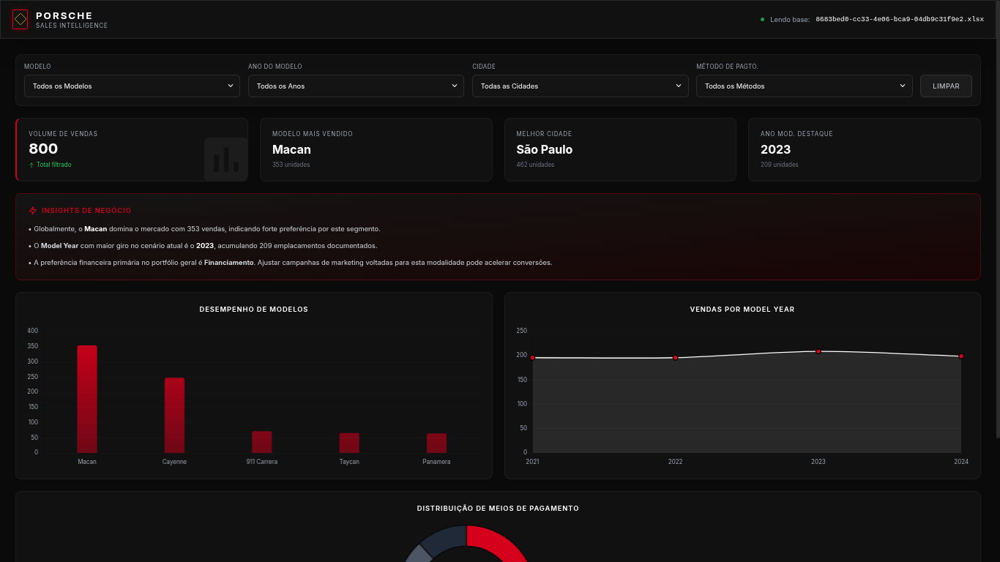

# Dashboard de Vendas da Porsche

🔗 **Acesse o projeto online:** [Clique aqui para visualizar o Dashboard](https://feliperios-data.github.io/dashboard_porsche_sales/)

Projeto desenvolvido para o desafio "Criando uma Dashboard da Porsche com Agentes de IA", parte do módulo "AI Reports com Excel, GPT Agents e Claude Code" da DIO (Digital Innovation One).

## 📸 Demonstração

*Painel de KPIs e gráficos interativos com filtros por modelo, cidade e método de pagamento*

## Sobre o Projeto

Dashboard analítico web single-page desenvolvido para simular inteligência de vendas de modelos Porsche. A aplicação foca na exibição e filtragem de métricas de negócios, operando via mock data.

## Tecnologias

*   **HTML5**
*   **Tailwind CSS**: Estilização via CDN.
*   **Chart.js**: Renderização dos gráficos de barras, linhas e rosca.
*   **JavaScript**: Lógica de geração de mock data, filtragem de dados e cálculo de KPIs.

## Funcionalidades

*   **Painel de KPIs:** Exibição do volume total de vendas, modelo mais vendido, melhor praça (cidade) e ano do modelo de maior destaque, atualizados em tempo real.
*   **Filtros:** Opções de segmentação cruzada por Modelo, Ano do Modelo, Cidade e Método de Pagamento.
*   **Motor de Insights:** Geração automática de texto analítico com base nos filtros selecionados, descrevendo aderência de modelos e perfil financeiro.
*   **Visualização Gráfica:** Gráficos interativos abordando desempenho por cidade, histórico de vendas por model year e distribuição de meios de pagamento.

## Como Executar

Basta acessar o link acima — a aplicação roda inteiramente no navegador, sem instalação ou download.

Alternativa local: clone o repositório e abra o arquivo `index.html` diretamente em um navegador web.
